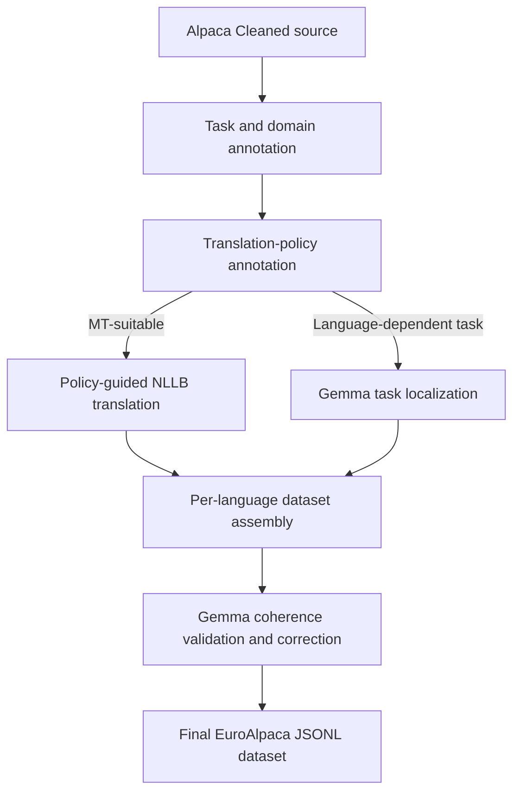
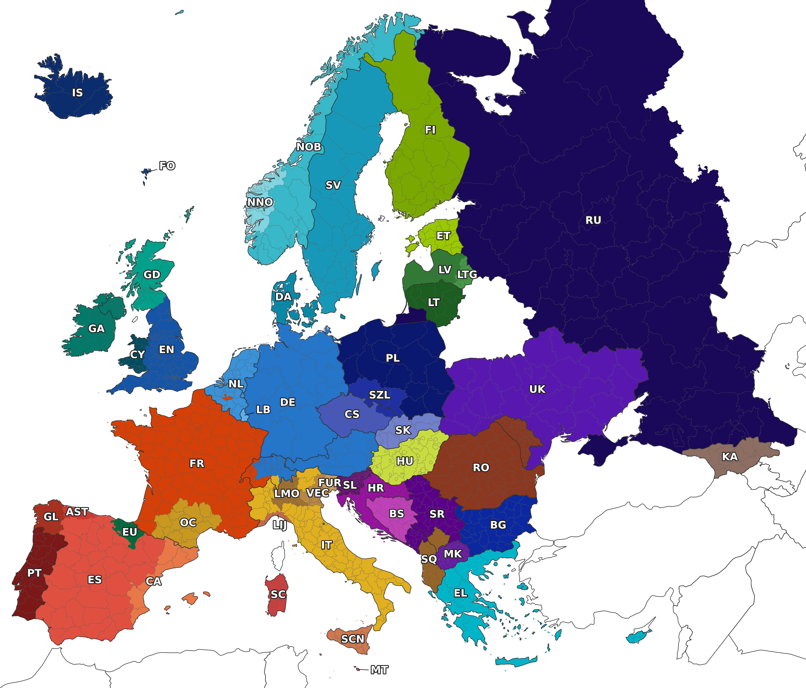

# EuroAlpaca


EuroAlpaca is a task-preserving localization pipeline for creating instruction-following data in 50 European languages and language varieties from an English Alpaca-style source dataset. Instead of translating every field literally, the pipeline identifies language-dependent tasks, chooses between translation and target-language localization, and validates the resulting samples for coherence.

The method is described in [*EuroAlpaca: Task-Preserving Localisation of Instruction Data for European Languages*](https://arxiv.org/abs/2609.05043), accepted at the INLG 2026 conference. The companion [European IFEval](https://github.com/Telefonica-Scientific-Research/european-ifeval) repository contains the separate multilingual instruction-following benchmark used for evaluation.

<br clear="right">

## How the pipeline works

Literal translation can invalidate tasks involving spelling, grammar, rhyme,
character counts, wordplay, idioms or other language-specific surface forms.
EuroAlpaca therefore routes each source sample through one of two branches.



The pipeline has eight executable stages.

1. Normalize the English source data and assign stable sample identifiers.
2. Annotate each sample with task and domain labels.
3. Choose a translation or localization route for each sample and define
   field-level translation policies.
4. Translate eligible fields with `facebook/nllb-200-3.3B`.
5. Localize tasks unsuitable for machine translation directly in each target
   language.
6. Assemble the translated and task-localized branches into a per-language
   dataset.
7. Validate coherence and produce targeted corrections.
8. Merge validated corrections into the final minimal records.

The histogram and task/domain split scripts are optional analysis utilities and
do not change the core pipeline.

## Repository contents

- `assets/` — figures used in the documentation.
- `data-pipeline/scripts/` — stage runners and their runtime configuration.
- `data-pipeline/src/alpaca_localization/` — Python implementation.
- `data-pipeline/tests/` — dependency-light pipeline unit tests.
- `data/` — ignored working area for source, intermediate and final datasets.
- `docs/method.md` — concise method notes.

## Requirements

- Python 3.10.
- A CUDA-capable environment suitable for NLLB-200 3.3B translation.
- Access to the [`facebook/nllb-200-3.3B`](https://huggingface.co/facebook/nllb-200-3.3B)
  model through Hugging Face. It is licensed under CC BY-NC 4.0 and intended
  for research rather than production deployment.
- An OpenAI-compatible `/chat/completions` endpoint serving
  [`google/gemma-4-31B-it`](https://huggingface.co/google/gemma-4-31B-it),
  released under Apache 2.0, as its fixed model for annotation, localization
  and validation. Starting and hosting that endpoint is outside this
  repository.

The following commands install the pipeline from a clean clone.

```bash
git clone https://github.com/Telefonica-Scientific-Research/EuroAlpaca.git
cd EuroAlpaca

pyenv install -s 3.10.0
pyenv local 3.10.0

python -m venv venv-euroalpaca
source venv-euroalpaca/bin/activate

python -m pip install --upgrade pip setuptools wheel
python -m pip install -r requirements.txt
python -m pip check
```

PyTorch installation depends on the CUDA version available on the host. If the
wheel selected by `pip` does not match the system, install the appropriate
PyTorch build first and then install the remaining requirements.

## Verify a clean installation

The unit tests do not load NLLB or contact the Gemma endpoint.

```bash
PYTHONPATH=data-pipeline/src \
python -m unittest discover -s data-pipeline/tests -v

find data-pipeline/scripts -name '*.sh' -print0 | xargs -0 -n1 bash -n
```

These checks validate source normalization, the shared 50-language
configuration, sample routing, duplicate detection and final-field merging.
They do not constitute a live model-inference test.

## Prepare the source data

The pipeline starts from the 51,760-record
[Alpaca Cleaned](https://github.com/gururise/AlpacaDataCleaned) dataset. Download
the source file into the ignored data directory and normalize it to JSONL.

```bash
export ALPACA_ROOT="${PWD}/data/alpaca_multilingual"
export LOG_ROOT="${PWD}/logs"

mkdir -p data/source
curl -L \
  https://raw.githubusercontent.com/gururise/AlpacaDataCleaned/main/alpaca_data_cleaned.json \
  -o data/source/alpaca_data_cleaned.json

bash data-pipeline/scripts/00_prepare_source.sh
```

The normalized source is written to the following path.

```text
${ALPACA_ROOT}/en/alpaca_cleaned.jsonl
```

Each record contains `sample_id`, `instruction`, `input` and `output`.

## Configure Gemma

Stages 1, 3, 5 and 7 expect the fixed-model chat-completions endpoint to be
running before they start. The default is shown below.

```bash
export GEMMA_ENDPOINT=http://127.0.0.1:10001/chat/completions
```

The server must accept `messages`, `temperature`, `max_tokens` and `stream`, and
return the generated text in `choices[0].message.content`. You can override
timeouts and token limits with the `GEMMA_*` variables shown in the individual
stage scripts. In stage 1, invalid labels receive safe defaults. A response
that cannot be parsed is retried up to eight times and then stops the stage
without dropping the sample.

## Run the complete pipeline

Run the following commands from the repository root after preparing the source
and starting Gemma.

```bash
export ALPACA_ROOT="${PWD}/data/alpaca_multilingual"
export LOG_ROOT="${PWD}/logs"

bash data-pipeline/scripts/01_annotate_tasks_domains.sh

# Optional analysis only
bash data-pipeline/scripts/01_make_task_domain_histograms.sh
bash data-pipeline/scripts/02_split_by_task_domain.sh

bash data-pipeline/scripts/03_annotate_translation_policies.sh
bash data-pipeline/scripts/04_translate_with_nllb.sh
bash data-pipeline/scripts/05_localize_discarded_samples.sh
bash data-pipeline/scripts/06_assemble_prevalidation_dataset.sh
bash data-pipeline/scripts/07_validate_translation_coherence.sh
bash data-pipeline/scripts/08_merge_validated_outputs.sh
```

These variables control where the pipeline writes generated data and logs. If
the repository filesystem lacks sufficient space, point `ALPACA_ROOT` and
`LOG_ROOT` to directories on a larger persistent filesystem. The downloaded
Alpaca Cleaned source remains at `data/source/alpaca_data_cleaned.json`. Set
these variables before stage 0 and keep them unchanged throughout a run. Avoid
using the temporary smoke-test directory for a complete run.

A full run creates 2,588,000 target-language records from 51,760 source
samples. Stage 7 can require one Gemma call per target-language record, so test
one language before starting all 50.

### Failure handling and quarantine

Model responses that cannot be parsed or do not match the required schema are
preserved for inspection.

- Stage 3 writes policy-annotation failures to
  `${ALPACA_ROOT}/en/annotation_parse_failures/`. The affected sample remains
  in the annotated data and is conservatively routed to stage 5.
- Stage 5 writes failed localizations to
  `${ALPACA_ROOT}/{lang}/quarantine/alpaca_discarded_samples_localized_gemma4_quarantine.jsonl`.
  It requires string `instruction`, `input` and `output` fields. `instruction`
  and `output` must be non-empty, while `input` may be empty. Failed samples are
  absent from stage 6 until they are successfully localized.
- Stage 7 writes failed validation responses to
  `${ALPACA_ROOT}/{lang}/quarantine/alpaca_cleaned_labeled_annotated_post_validated_gemma4_quarantine.jsonl`.
  If stage 7 cannot produce a valid response after its repair attempts, stage 8
  keeps the original stage-6 sample unchanged in the final dataset. The stage-7
  quarantine file records the affected sample and failure details for review.
  To apply a manual correction, update the corresponding stage-6 sample and
  rerun stages 7 and 8 for that language.

Resume mode treats quarantined samples as already processed and does not retry
them automatically. Quarantine files contain diagnostic records and must not be
appended directly to a dataset. For a clean rerun, use a new empty
`ALPACA_ROOT`. When resuming a partial stage-4 or stage-5 run, keep its JSONL
output and adjacent `.state.json` checkpoint file together.

If stage 5 quarantines one or more samples, stage 6 stops because the
translated and localized branches no longer cover every source sample. To
recover the missing localized records, use each quarantine record's
`source_sample` to produce a corrected target-language record in a separate
file. Verify its `sample_id`, string `instruction`, `input` and `output`, and
language tag, then merge the verified records into
`${ALPACA_ROOT}/{lang}/alpaca_discarded_samples_localized_gemma4.jsonl`. Keep
the quarantine file as an audit record. Rerun stage 6 to rebuild the complete
prevalidation dataset.

After stage 3, the following command produces a textual policy summary without
invoking a model.

```bash
PYTHONPATH=data-pipeline/src \
python -m alpaca_localization.annotation_statistics \
  --input "${ALPACA_ROOT}/en/alpaca_cleaned_labeled_annotated_gemma4.jsonl"
```

By default, stages 4–8 process all 50 target languages. The following example
restricts each stage to German and Catalan.

```bash
bash data-pipeline/scripts/04_translate_with_nllb.sh de ca
bash data-pipeline/scripts/05_localize_discarded_samples.sh de ca
bash data-pipeline/scripts/06_assemble_prevalidation_dataset.sh de ca
bash data-pipeline/scripts/07_validate_translation_coherence.sh de ca
bash data-pipeline/scripts/08_merge_validated_outputs.sh de ca
```

For NLLB translation across multiple GPUs, set a space-separated GPU list as
shown below.

```bash
GPUS="0 1 2 3" \
bash data-pipeline/scripts/04_translate_with_nllb_multi_gpu.sh
```

If stage 4 reports any input-truncation or output-length-cap warnings, increase
`MAX_INPUT_TOKENS` or `MAX_NEW_TOKENS` and rerun before using the output.

## Small German integration run

This small integration run executes the NLLB translation and Gemma stages on
ten samples. It requires a running Gemma endpoint and enough GPU memory to load
NLLB-200 3.3B. The `LIMIT=10` setting in stage 0 ensures that all later stages
process the same ten-sample subset.

```bash
export ALPACA_ROOT=/tmp/euroalpaca-smoke/data
export LOG_ROOT=/tmp/euroalpaca-smoke/logs

LIMIT=10 bash data-pipeline/scripts/00_prepare_source.sh
bash data-pipeline/scripts/01_annotate_tasks_domains.sh
bash data-pipeline/scripts/03_annotate_translation_policies.sh

bash data-pipeline/scripts/04_translate_with_nllb.sh de
bash data-pipeline/scripts/05_localize_discarded_samples.sh de
bash data-pipeline/scripts/06_assemble_prevalidation_dataset.sh de
bash data-pipeline/scripts/07_validate_translation_coherence.sh de
bash data-pipeline/scripts/08_merge_validated_outputs.sh de
```

This keeps the smoke-test artifacts separate from the default full-run data.

## Outputs

The default working root is `data/alpaca_multilingual`. The important artifacts
are listed below.

| Stage | Default output |
|---|---|
| 0 | `en/alpaca_cleaned.jsonl` |
| 1 | `en/alpaca_cleaned_labeled_gemma4.jsonl` |
| 3 | `en/alpaca_cleaned_labeled_annotated_gemma4.jsonl` |
| 4 | `{lang}/alpaca_cleaned_labeled_translated.jsonl` |
| 5 | `{lang}/alpaca_discarded_samples_localized_gemma4.jsonl` |
| 6 | `{lang}/alpaca_cleaned_labeled_annotated_gemma4.jsonl` |
| 7 | `{lang}/alpaca_cleaned_labeled_annotated_post_validated_gemma4.jsonl` |
| 8 | `{lang}/alpaca_cleaned_labeled_annotated_post_validated_gemma4_final.jsonl` |

The final file contains one JSON object per line with the following schema.

```json
{
  "sample_id": 1,
  "instruction": "...",
  "input": "...",
  "output": "...",
  "language": "de"
}
```

Use `ALPACA_ROOT=/path/to/workdir` to place all generated artifacts elsewhere.
Stage-specific `INPUT`, `OUTPUT`, `INPUT_JSONL`, `OUTPUT_JSONL` and
`OUTPUT_ROOT` variables can override individual paths.

## Languages



*Approximate traditional geographic areas associated with the languages and
regional varieties covered by EuroAlpaca. Boundaries are schematic and do not
represent exclusive or current speaker distributions.*

The source language is English (`en`). The target set is shown below.

| Code | Language | Code | Language |
|---|---|---|---|
| `ast` | Asturian | `bg` | Bulgarian |
| `bs` | Bosnian | `ca` | Catalan |
| `cs` | Czech | `cy` | Welsh |
| `da` | Danish | `de` | German |
| `el` | Greek | `es` | Spanish |
| `et` | Estonian | `eu` | Basque |
| `fi` | Finnish | `fo` | Faroese |
| `fr` | French | `fur` | Friulian |
| `ga` | Irish | `gd` | Scottish Gaelic |
| `gl` | Galician | `hr` | Croatian |
| `hu` | Hungarian | `is` | Icelandic |
| `it` | Italian | `ka` | Georgian |
| `lb` | Luxembourgish | `lij` | Ligurian |
| `lmo` | Lombard | `lt` | Lithuanian |
| `ltg` | Latgalian | `lv` | Latvian |
| `mk` | Macedonian | `mt` | Maltese |
| `nl` | Dutch | `nno` | Norwegian Nynorsk |
| `nob` | Norwegian Bokmål | `oci` | Occitan |
| `pl` | Polish | `pt` | Portuguese |
| `ro` | Romanian | `ru` | Russian |
| `sc` | Sardinian | `scn` | Sicilian |
| `sk` | Slovak | `sl` | Slovenian |
| `sq` | Albanian | `sr` | Serbian |
| `sv` | Swedish | `szl` | Silesian |
| `uk` | Ukrainian | `vec` | Venetian |

The pipeline uses NLLB tags `nob`, `nno` and `oci`. Released datasets or paper
tables may abbreviate these as `no`, `nn` and `oc`.

## EuroAlpaca dataset

The generated EuroAlpaca data are published in the [EuroAlpaca](https://huggingface.co/datasets/Telefonica/EuroAlpaca) Hugging Face dataset repository. The dataset provides a separate subset for every target language. Each subset uses the language codes listed above and contains the final `sample_id`, `instruction`, `input`, `output` and `language` fields.

## License

The EuroAlpaca source code is licensed under the [Apache License 2.0](LICENSE).

Alpaca Cleaned is distributed under the [CC BY-NC 4.0
license](https://github.com/gururise/AlpacaDataCleaned/blob/main/DATA_LICENSE).
It is downloaded separately and is not included in this repository. The Apache
2.0 license applies only to the EuroAlpaca source code. Alpaca Cleaned and
datasets derived from it remain subject to the upstream dataset terms.

Other external datasets, models and dependencies retain their own license
terms.
